<div align="center">

# QuantumOrb

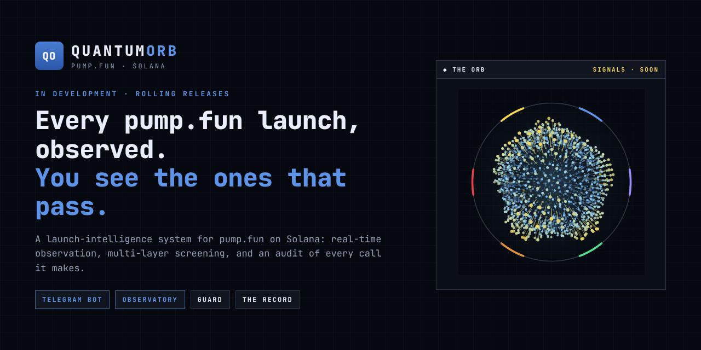

**Launch intelligence for pump.fun on Solana.**


</div>

> **In development.** QuantumOrb is being released in stages over the coming days. This repository is
> the public face of the project while the source stays closed: what it is, what it looks like, and the
> shape of its interfaces.

---

Some twenty-five thousand coins launch on pump.fun on a typical day. Almost none of them ever fill their
bonding curve, and a large share come from wallets that launch by the hundred and walk away from every
one. QuantumOrb watches all of them in their first minutes and tells you about the few that hold up -
and then, an hour later, checks its own call.

It is two things built on the same discipline:

- **Sentinel**, a Telegram bot: launches that pass *your* filters and a multi-layer screen, the tokens,
  wallets and creators you choose to follow, and a public audit of every alert it ever sends.
- **The Observatory**, a site: the model the project is building - **the Orb**, which holds each launch
  as a probability state and collapses it into a decision only when the edge survives every cost -
  laid out over live market data.

## Four layers

| | |
|---|---|
| **Observation** | every pump.fun launch read as it happens, re-examined while it is young |
| **Guard** | a screen on the creator's history and on the token itself, read from the chain - a launch is held back only on evidence |
| **Tracking** | tokens, wallets and creators followed for you, with the moments that matter and nothing else |
| **The Record** | every call written down when it is made and measured an hour later, in public |

Behind the Observatory sits **the Orb**, in development: six agents - observation, mapping, judgement,
pricing, screening, execution - feeding one probability state over three outcomes. It starts in research
mode: decisions logged, nothing traded, no signals published.

## Glimpses

Development builds. The project's name, the names of coins and wallets, addresses, figures and the
descriptions of each item are hidden. The bot's pictures are its own formatter on recorded data; the
Observatory's are captured with the live engine off, so the values on them come from its sample engine.

### Sentinel · the bot

<table>
<tr>
<td width="50%" valign="top">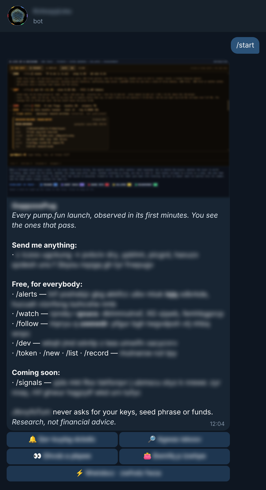<br>
<sub><b>Start.</b> The welcome card and the menu: free tools for everybody, one thing marked as coming. What each item does stays hidden until R1.</sub></td>
<td width="50%" valign="top">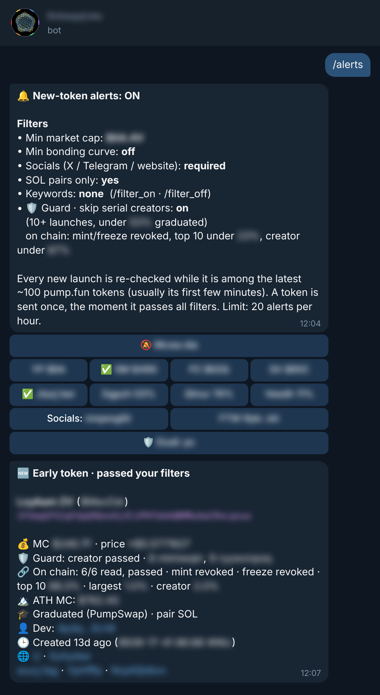<br>
<sub><b>Alerts.</b> Your filters, one tap each - and below them, an early launch that just passed them and the screen, with the reasons it passed.</sub></td>
</tr>
<tr>
<td valign="top">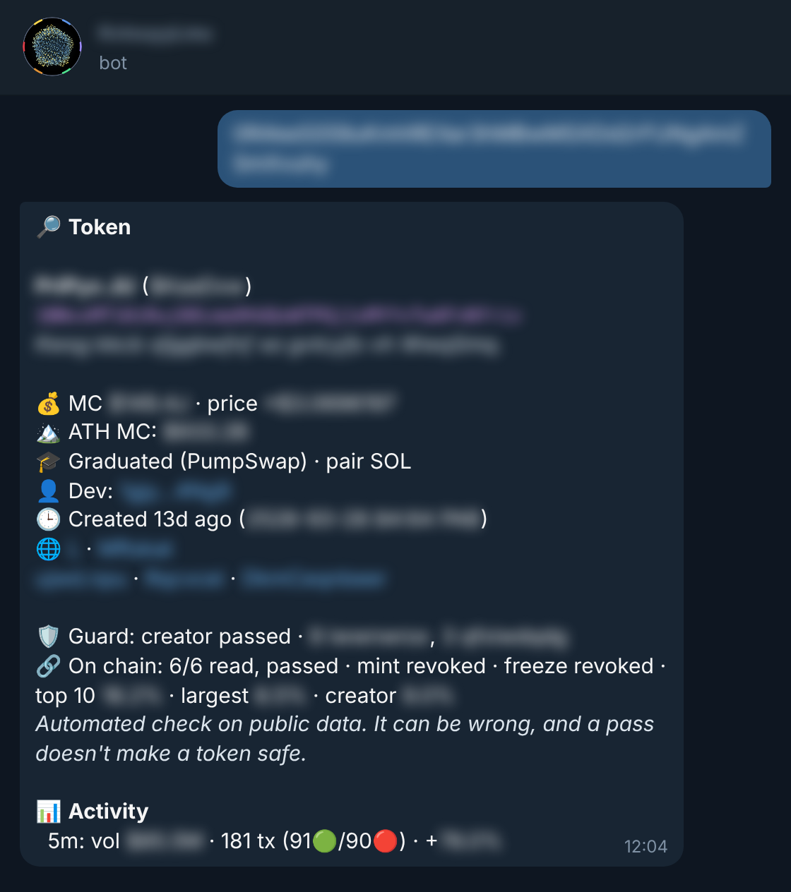<br>
<sub><b>Any token, on demand.</b> Send an address, get its card: where it stands, what traded, who made it, and what the chain says about it.</sub></td>
<td valign="top">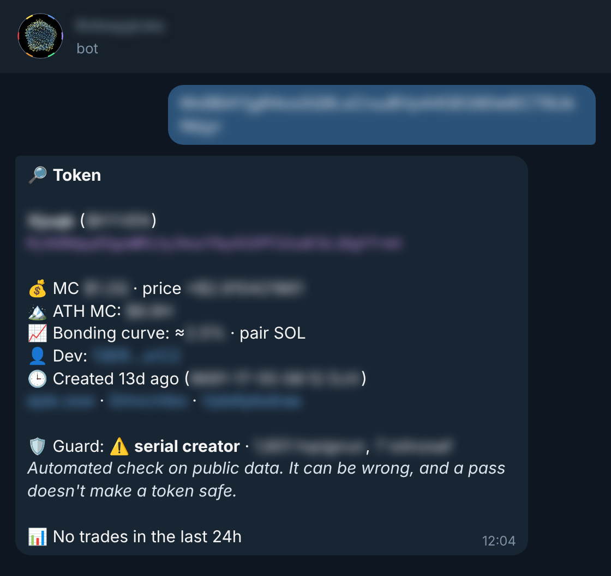<br>
<sub><b>Guard at work.</b> A launch from a wallet that launches by the hundred: flagged, with the evidence attached - and kept out of the alert feed.</sub></td>
</tr>
<tr>
<td valign="top">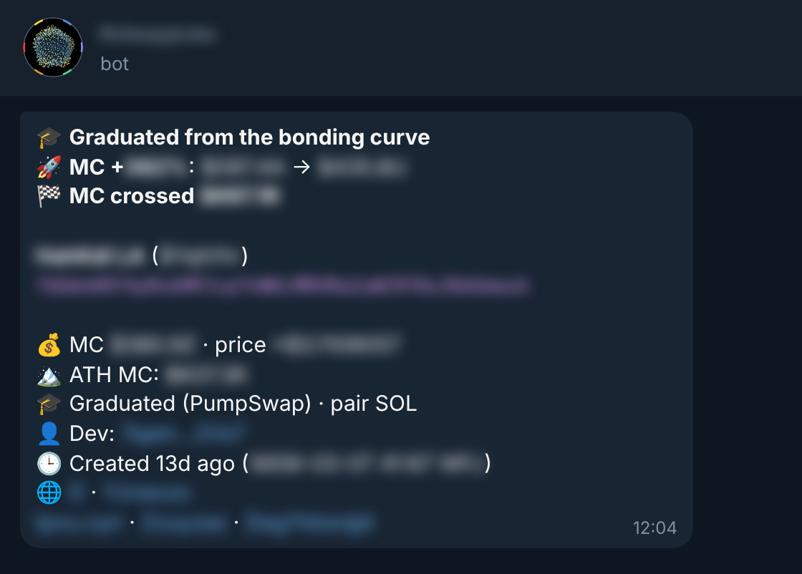<br>
<sub><b>Watch.</b> A token you follow graduates, moves and crosses a milestone - every reason in one message, not three.</sub></td>
<td valign="top">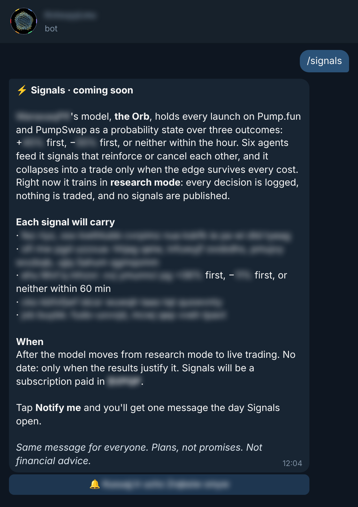<br>
<sub><b>Signals, coming.</b> What a signal will carry and when it opens: only after the model leaves research mode, and only if the results justify it.</sub></td>
</tr>
</table>

### The Observatory · the site

<p align="center">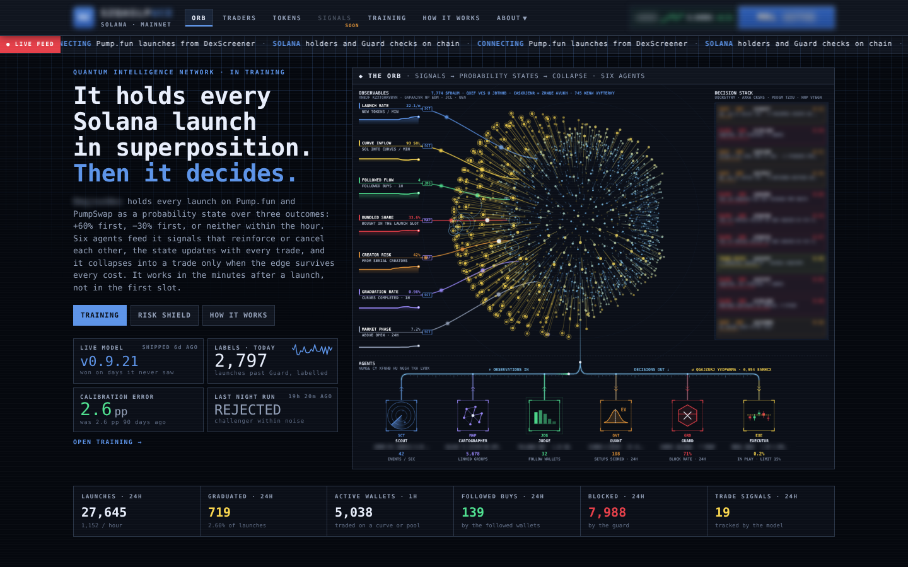<br>
<sub><b>The Orb.</b> Every launch held as a probability state: observables stream in on the left, six agents branch out below, the decision stack fills on the right, the day's counters along the bottom.</sub></p>

<p align="center">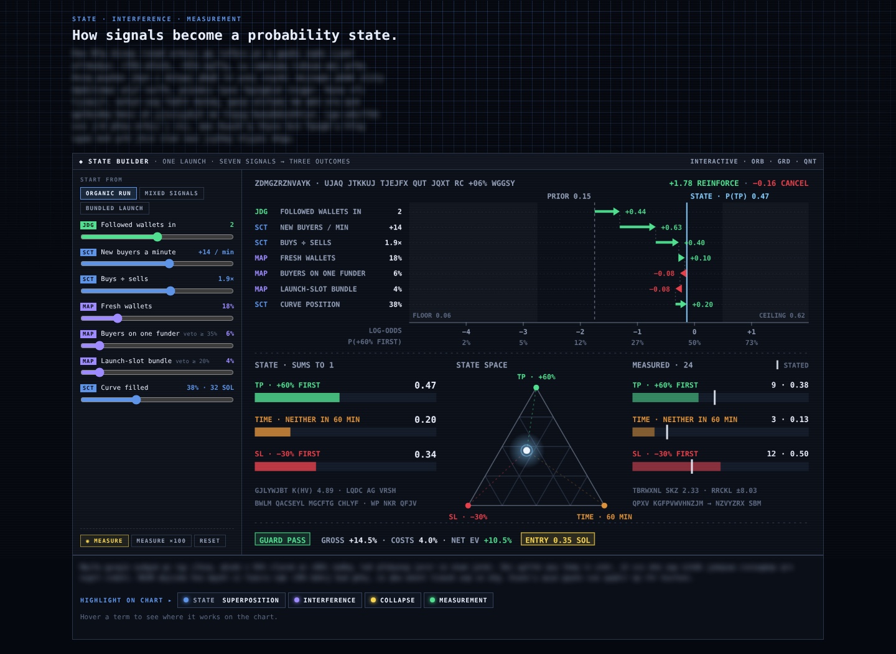<br>
<sub><b>State builder.</b> Seven signals move one launch between three outcomes. Agreement reinforces, conflict cancels, and the state only collapses into an entry when the edge clears every cost.</sub></p>

<p align="center">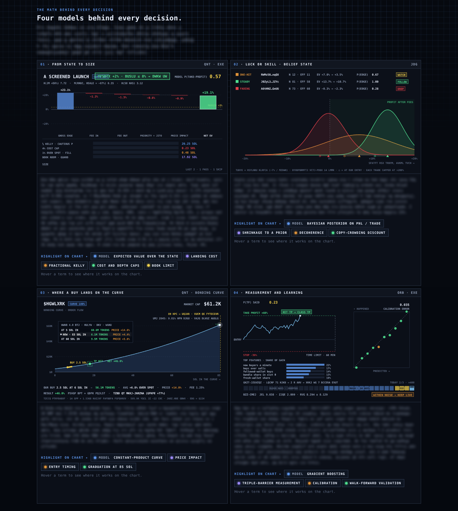<br>
<sub><b>Four models behind every decision.</b> From state to size, luck or skill, where a buy lands on the curve, and how the model is measured and retrained. The method notes are hidden.</sub></p>

<table>
<tr>
<td width="50%" valign="top">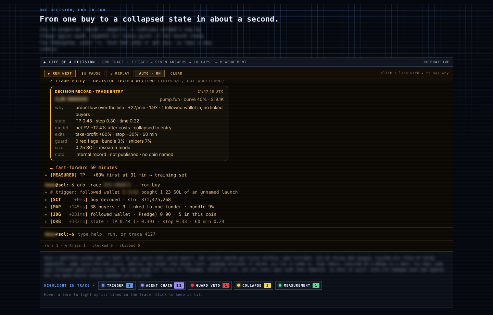<br>
<sub><b>One decision, end to end.</b> From a single buy on the chain to a collapsed state in about a second - every agent's answer in order, then the decision record.</sub></td>
<td width="50%" valign="top">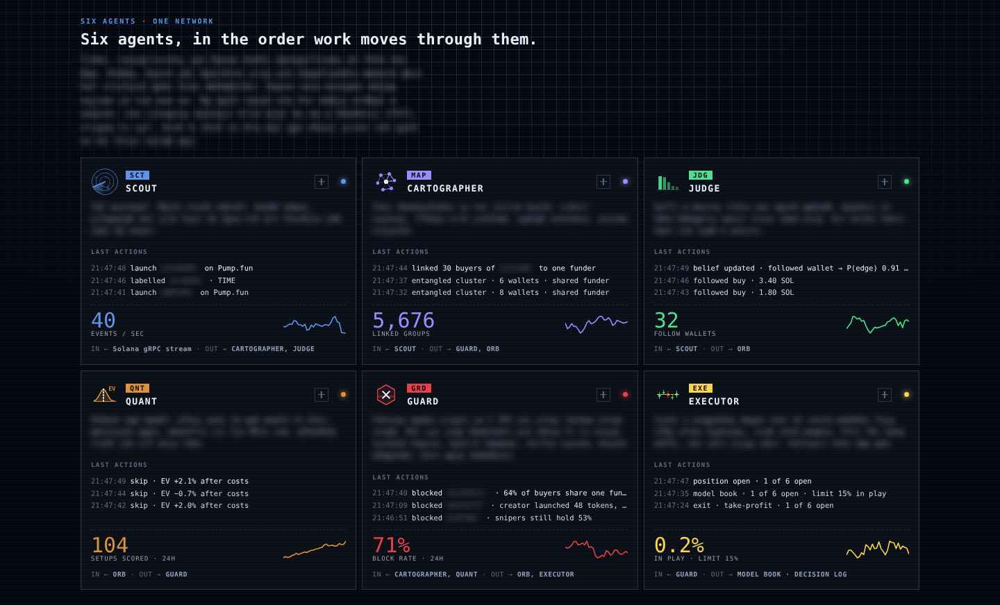<br>
<sub><b>Six agents.</b> Scout, Cartographer, Judge, Quant, Guard, Executor - what each one watches, what it did last, and where its answer goes next.</sub></td>
</tr>
</table>

<p align="center">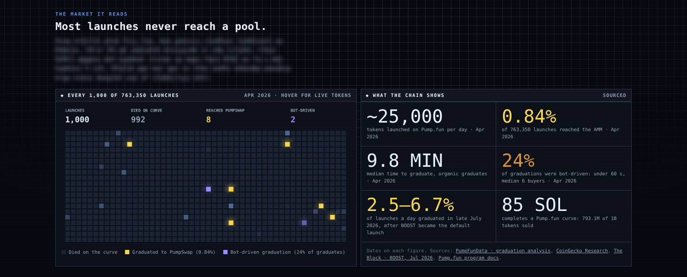<br>
<sub><b>The market it reads.</b> How few launches ever reach a pool, and how many of those that do were pushed there by bots. Public, sourced figures, dated on the card.</sub></p>

## How it fits together

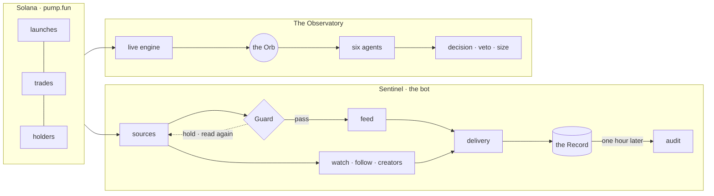

More in [`docs/architecture.md`](docs/architecture.md).

## What is in this repository

```
interfaces/     33 module contracts: the bot as .pyi, the site's server as .d.ts - signatures, no bodies
docs/           architecture, and the screens above
vault/          the seal's verifier in Python: scheme, Merkle proofs, manifest, ledger, diffs, contract audit
examples/       the same verifier in JavaScript, for Node and for the browser, and proofs to try it on
sealed/         the current seal, every earlier one, and the ledger that chains them
schemas/        the seal's file formats as JSON Schema
tools/          the stable entry point, and the contract cutter
tests/          frozen vectors, every proof of every tree size, tampering of every kind
```
The contracts in [`interfaces/`](interfaces/) are the shape of the system as it stands
([`interfaces/INDEX.md`](interfaces/INDEX.md)). Signatures only - there is nothing here to import or to run.

## Releases

| | Codename | What opens | |
|---|---|---|---|
| R0 | **Vault** | this repository: the showcase and the interfaces | ● live |
| R1 | **Sentinel** | the Telegram bot, closed beta: launch feed, Guard, tracking | ○ next |
| R2 | **Observatory** | the site, public: the Orb over live market data | ○ soon |
| R3 | **Ledger** | the Record in public: every call, audited an hour later | ○ soon |
| R4 | **Collapse** | Signals - only after the model leaves research mode, and only if the results justify it | ○ no date |

Rolling out over the coming days. Links appear here when each part opens - not before.
[`CHANGELOG.md`](CHANGELOG.md) keeps the record.

## Stack

Python 3.11+ · aiogram 3 · aiohttp · SQLite (WAL, versioned migrations) · Solana JSON-RPC · Node 20 ·
Express · helmet · esbuild · Playwright · systemd · Nginx · GitHub Actions

## Authorship seal

The closed source is fingerprinted file by file and folded into one root published here. Nothing can be
read from it; it fixes that the code existed, and when, so that can be shown later without showing the
code now. How it works: [`SEAL.md`](SEAL.md).

<!-- vault:seal -->
```
root      8dd6c93e05b537f1972771a8f1aff150c3d83db4a7dc67cff276e0e8bf131af8
sealed    2026-10-12 22:24 UTC
files     155        lines     18,179        size     7.0 MB
```
<!-- /vault:seal -->

<details>
<summary>By component, and every seal so far</summary>

<!-- vault:components -->
| Component | Files | Lines | Size |
|---|---:|---:|---:|
| bot · sources | 4 | 695 | 29 KB |
| bot · pipeline | 9 | 938 | 42 KB |
| bot · interface | 6 | 1,378 | 56 KB |
| bot · core | 9 | 1,288 | 56 KB |
| bot · tests + fixtures | 32 | 2,302 | 88 KB |
| observatory · server | 12 | 2,362 | 258 KB |
| observatory · client | 4 | 1,979 | 180 KB |
| observatory · public | 12 | 2,879 | 1,161 KB |
| observatory · build & tests | 11 | 1,839 | 68 KB |
| infrastructure | 17 | 623 | 22 KB |
| documentation, tooling, brand, repository | 39 | 1,896 | 5,202 KB |
<!-- /vault:components -->

<!-- vault:ledger -->
| # | Sealed (UTC) | Files | Lines | Δ lines | Root | Note |
|---:|---|---:|---:|---:|---|---|
| 1 | 2026-10-12 21:22 | 155 | 18,134 |  | `145d2c1fd7991bcc…` | R0 · Vault: the first seal, published with the showcase |
| 2 | 2026-10-12 21:57 | 155 | 18,168 | +34 | `d2043ae438efb329…` | screens hide the project's name; the vault, the ledger and complete contracts |
| 3 | 2026-10-12 22:24 | 155 | 18,179 | +11 | `8dd6c93e05b537f1…` | screens hide the token widget whole |
<!-- /vault:ledger -->

Check it with Python (`python -m vault ledger --verify`), Node (`node examples/js/verify.mjs`) or in the
browser ([`examples/browser/`](examples/browser/)).

</details>

## Not advice

QuantumOrb is a research project. Guard is an automated check on public data: it can be wrong, and a pass
does not make a token safe. Nothing here is financial advice, and nothing in this repository places a
trade. QuantumOrb is not affiliated with pump.fun, Solana or Telegram. QuantumOrb will never ask for a
private key, a seed phrase or funds ([`SECURITY.md`](SECURITY.md)).

## License

All rights reserved. See [LICENSE](LICENSE): this repository may be viewed and its seal verified; it may
not be copied, run or redistributed.
