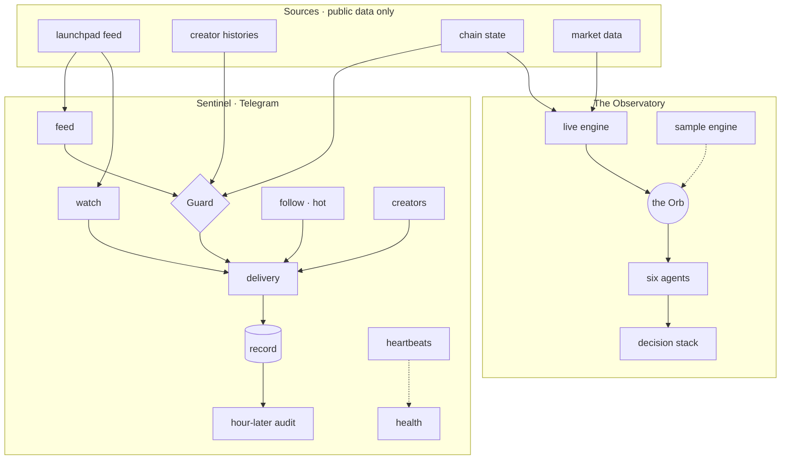

# Architecture

How QuantumOrb is put together, at the level of what each part is responsible for. The thresholds, the
data sources' exact routes, the models' parameters and the code stay sealed; the shape does not.

## Two surfaces, one discipline

Both read only public data. Neither holds a key to anybody's funds, and neither will ever ask for one.

## Sentinel

**Sources.** One adapter per outside service, each split into the part that talks to the network and pure
parsers that turn an answer into something the rest of the system can trust. Every adapter is throttled to
the service's own pace, shares that allowance across every loop in the process, and fails soft: an outage is
logged once and the loop carries on with what it has. Where several public endpoints serve the same data,
they are rotated - one that refuses is rested, the last one that answered is asked first.

**Guard.** Two halves. The *creator* half reads the launching wallet's history and recognises the pattern of
a serial launcher. The *chain* half reads the token itself: its authorities, its token program's extensions,
and how its supply is distributed once the curve and the pool are set aside - holders are told apart by who
owns them, not by a list of known addresses. A check that could not be read is shown as *not read* and never
fails a token. A launch is held back only on evidence, and read again while it is still young.

**The loops.** A feed that re-examines every young launch against every subscriber's own filters; watches
that fire on graduation, moves and milestones, all reasons in one message; wallet tracking with a *hot*
signal built only from a subscriber's own list. Each loop writes a heartbeat; health is judged by staleness,
not by errors, because a quiet failure and a quiet market look identical from outside.

**The Record.** Every alert is written down when it goes out and measured again an hour later, against the
launchpad's own numbers. What reached a peak inside the hour is counted only when the peak can be dated
inside it. It is reported before fees, and it never presents itself as trading.

**Storage.** SQLite in WAL mode: a compatible baseline that still opens the earliest databases, numbered
migrations above it, nothing that identifies a subscriber ever leaving it.

## The Observatory

**Server and page.** Everything that computes runs on the server - the models, the live engine, the sample
engine, every outside call. The page only draws: it receives finished numbers and strings, and a build check
refuses any bundle in which a model, a host, a key or a switch has leaked into a file a visitor downloads.

**The Orb** (in development - what the Observatory shows today is its design, run on the sample engine
where live inputs are not wired yet). Each launch is held as a probability state over three outcomes. Signals add signed
contributions, so agreement reinforces and conflict cancels; old evidence fades; the state collapses into a
decision - entry, skip or veto - only when the expected value clears every cost. Six agents answer in turn:
observation, mapping, judgement, pricing, screening, execution.

**Learning** (designed, not yet live). Every launch that passes the screen is to become a measured outcome;
a model retrained on a rolling window ships only if it beats the live recipe on days neither has seen.
It starts in research mode: decisions logged, nothing traded, no signals published.

## Operating it

One small server runs both surfaces under systemd, each unit confined to the one directory it may write.
Nginx is the only thing listening outside. Deploys run the full test suites on the server before anything is
restarted, and read the page body afterwards - a page can answer 200 and still be broken. Secrets live in
environment files on the server and are stripped from every log line.
