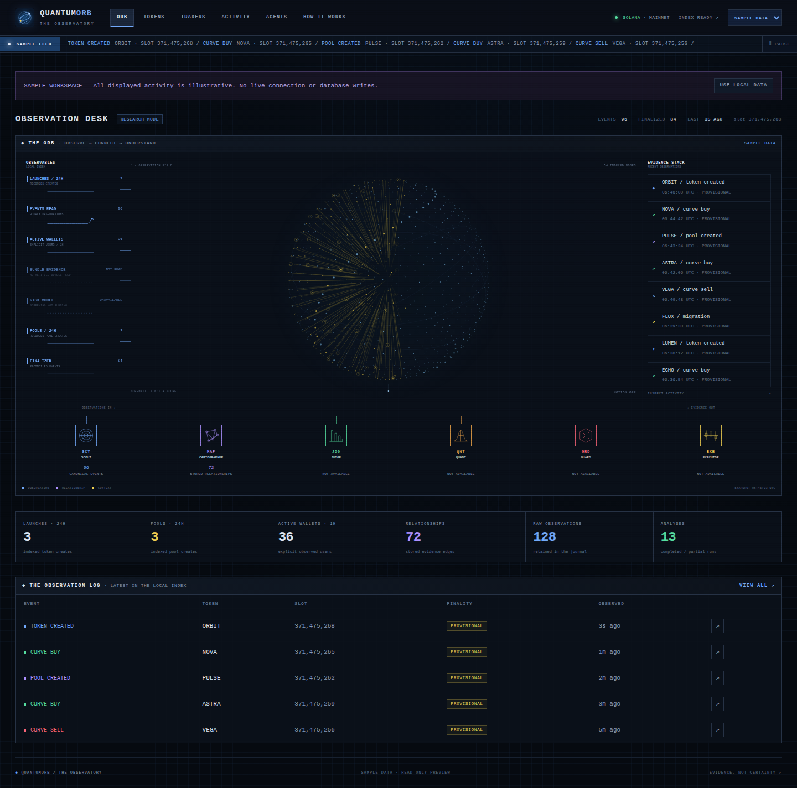

# QuantumOrb personal backend

The local backend records raw Solana evidence, normalizes Scout events, and builds
bounded Cartographer graphs and summaries. Demo operations run offline. Live
intake and history requests are explicit commands. No provider connection starts
when the API is imported or its health endpoints are read.

## Local setup

From this directory, with Python 3.11 or newer:

```bash
python -m venv .venv
source .venv/bin/activate
python -m pip install -c constraints-dev.txt -e '.[dev]'
python -m scripts.manage init-db
python -m scripts.manage health
uvicorn app.main:app --host 127.0.0.1 --port 8000
```

Database migrations are explicit. Readiness returns 503 until the required
tables and columns exist. Liveness remains available without a database or key.
`/health/ready`, `/health/details`, and `/metrics` read local state. Provider and
ingestion state remain `not_read` unless an actual connection is observed; local
readiness does not claim that provider authentication has been verified.

## Observatory dashboard

Open `http://127.0.0.1:8000/` after starting the local server. The observation
desk follows the README's Observatory screens: an animated Orb, incoming
observables, evidence stack, six agent panels and indexed activity counters.
There is no marketing hero section.



- **Orb:** index counts, recent events, motion controls and automatic refresh pause.
- **Tokens:** mint/creator search, lifecycle filters, pagination and token dossiers.
- **Traders:** observed wallets, event/trade counts and wallet activity drilldown.
- **Activity:** address/signature search, observation windows and finality filters.
- **Agents:** recorded Scout/Cartographer activity and explicit planned-agent states.
- **System:** readiness, freshness, hourly observations and bounded graph export.

Token dossiers show coverage, unknown funding/bundle evidence, warnings and actual
stored relationship graphs. Select a graph node to copy its public identifier.
Graph and table downloads are bounded public JSON exports. Raw provider payloads
and private token metadata are excluded from these views.

The default source is **Local data**. Select **Sample data** in the header, or
open `/?source=demo`, to explore an explicitly labeled illustrative workspace.
Sample mode runs in the browser and never writes to storage or contacts a
provider. The source preference is stored locally; override it with
`/?source=local`. Only this display preference is stored in browser storage.

The Orb is a pipeline schematic. Actual typed relationships appear in token
dossiers. Judge, Quant, Guard and Executor remain unavailable; no scores are
invented and no execution is enabled.

Read-only APIs are `GET /api/dashboard`, `/api/tokens`, `/api/wallets` and
`/api/activity`. Lists accept a bounded `limit` (1–100), `offset` (0–100000) and
public address-prefix query. Activity/wallet windows use local observation time
(`all`, `1h`, `24h`, `7d`). Tokens accept lifecycle filters; activity accepts
finality filters. Unavailable storage never becomes fabricated zero activity.

## Replay and inspect evidence

```bash
python -m scripts.manage replay ../coding-pack/fixtures/helius/pump-create-event.json --passes 2
python -m scripts.manage replay --after-id 0 --limit 1000
python -m scripts.manage analyze-token <public-mint-address>
python -m scripts.manage export-graph --mint <public-mint-address> --output graph.json
```

Fixture and supported raw-transaction replay use the same decoder/normalizer
interfaces as intake, preserve raw hashes, and deduplicate canonical events.
Unknown contexts remain quarantined. Parsed notification replay that lacks its
discovery context stays unavailable. A replay limit exposes a continuation raw
ID and truncation flag. Exports contain public graph identifiers, typed edges,
evidence counts and freshness; raw bodies, metadata and evidence details stay in
local storage. Export files require a new filename and are never overwritten.

`GET /cartographer/tokens/<mint>` returns the latest persisted summary. A missing
summary returns 404. `GET /graph/export?mint=<mint>&limit=1000` provides the same
bounded export. Missing funding history remains unknown in offline summaries.

## Explicit live work

Configure the server-side environment using `.env.example`: live mode, mainnet,
one selected provider transport, and a private provider API key. Then run:

```bash
python -m scripts.manage listen --live
python -m scripts.manage analyze-token <public-mint-address> --live
```

The listener uses bounded recovery and the configured transport. Cancellation
preserves its recovery boundary. History analysis uses the saved canonical target
set and configured wallet, transaction, lookback and counterparty limits. The
API itself does not start these jobs. Confirmed activity remains provisional;
live provider sessions and automatic finality scheduling require operational
verification. Tests exercise those components through injected offline adapters.

## Quality checks

```bash
python -m pip check
env -u HELIUS_API_KEY python -m scripts.verify_contracts
env -u HELIUS_API_KEY python -m pytest -q
ruff check .
ruff format --check .
python -m mypy app scripts
node --test tests/js/dashboard.test.mjs
```

CI runs this gate on Python 3.11, 3.12 and 3.13 with the tested dependency
constraints. No live credentials are supplied. The contract command validates
all eight vault/backend schemas, verifies both pinned IDL hashes, creates a
temporary database with Alembic, checks for migration drift, and replays each of
the three Scout golden fixtures twice through the application pipeline. Golden
mismatches report the fixture and JSON path and return a nonzero exit status.
Its selected stable fields are explicitly listed in `scripts/verify_contracts.py`.
The pytest suite also covers the funding, temporal uncertainty and full summary
golden contracts, local HTTP routes, safe exports and replay idempotence. The
contract gate has a test that rejects any attempted network connection.

The broader sealed vault and its tests remain separate from this backend; the
same CI workflow also verifies its seal, ledger, contracts and JavaScript proofs.

For an optional desktop/mobile acceptance pass, install Playwright in a separate
test environment. Start a loopback server against a temporary migrated database,
replay the three checked-in create/trade/pool fixtures, and run an offline
`analyze-token` for their shared mint. Then run:

```bash
python tests/browser/check_dashboard.py --base-url http://127.0.0.1:8765
```

The browser check covers actual local data, sample isolation, filtering,
pagination, graph downloads, reduced motion, mobile navigation and unavailable
storage recovery. Screenshots go to `/tmp/quantumorb-dashboard-review`.
